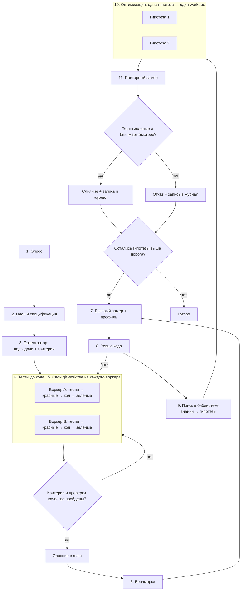

# Пайплайн разработки и оптимизации кода на GDScript

Порядок работы над задачей в Godot 4 на GDScript: от постановки до кода с зелёными тестами, затем цикл оптимизации. В цикле код ускоряется только по замерам, а каждая правка опирается на источник из библиотеки знаний скилла. Пайплайн подходит для 2D и 3D игр, UI, инструментов редактора, мультиплеера и приложений на Godot. Команды и скрипты проверены на Godot 4.7.2 (октябрь 2026).

- [Схема](#схема)
- [Роли и модели](#роли-и-модели)
- [Этапы](#этапы)
- [Обязательные проверки качества](#обязательные-проверки-качества)
- [Этап 4. Что тестировать](#этап-4-что-тестировать)
- [Этап 6. Бенчмарки](#этап-6-бенчмарки)
- [Этап 7. Базовый замер и профиль](#этап-7-базовый-замер-и-профиль)
- [Этап 8. Ревью кода](#этап-8-ревью-кода)
- [Этап 9. Поиск в библиотеке знаний](#этап-9-поиск-в-библиотеке-знаний)
- [Этапы 10–11. Оптимизация и повторный замер](#этапы-1011-оптимизация-и-повторный-замер)
- [Короткий режим](#короткий-режим)
- [Почему так](#почему-так)

## Схема



## Роли и модели

Пайплайн рассчитан на агента с субагентами. Если субагентов нет, один агент проходит те же этапы последовательно, а вместо worktree использует отдельные ветки.

| Роль | Рекомендуемая модель | Этапы |
| --- | --- | --- |
| Оркестратор: опрос, план, распределение работы, ревью, поиск решений, приёмка | Старшая модель, например Claude Opus 5.5 | 1–3, приёмка, 8, 9, решение на 11 |
| Воркер: основной код, тесты, бенчмарки, оптимизации | Средняя модель, например Claude Sonnet 5.5 | 4, 6, 10 |
| Рутина: простые правки, прогоны команд, сбор цифр | Быстрая модель, например Claude Haiku 4.5 | 4 (рутина), 7, 11 (замер) |

Старшая модель только управляет и проверяет. Основной объём кода пишут более дешёвые модели.

Агент работает из терминала и не видит игру. Всё, что можно проверить кодом (логика, данные, сигналы, сохранения), проверяется тестами и headless-прогонами. То, что требует глаз (анимация, ощущение управления, вёрстка UI), оркестратор явно передаёт человеку на ручную проверку со списком, что смотреть.

## Этапы

| Этап | Что делает | Команда агенту |
| --- | --- | --- |
| 1. Опрос | Задаёт уточняющие вопросы: версия Godot, 2D или 3D, рендерер (Forward+, Mobile, Compatibility), целевые платформы (desktop, web, mobile), мультиплеер, бюджет кадра (16,6 мс для 60 FPS), нужна ли связка с C# или GDExtension | «Прежде чем начать, задай мне вопросы по задаче» |
| 2. План и спецификация | Фиксирует план и спеку файлом. Отдельно перечисляет горячие пути и бюджет производительности: что выполняется каждый кадр, сколько объектов на экране, что должно грузиться без фризов | «Составь план и спецификацию, отдельно перечисли то, что работает каждый кадр, и бюджеты» |
| 3. Оркестратор | Делит план на независимые подзадачи с критериями приёмки. Структуру сцен, автозагрузки и поток сигналов сверяет с [architecture.md](architecture.md) | «Разбей план на подзадачи с критериями готовности» |
| 4. Тесты до кода | Пишет тесты GUT или gdUnit4 по спеке, видит красные, пишет код и чинит до зелёных | «Сначала тесты по спеке, запусти headless — должны быть красными. Потом код, пока все не зелёные» |
| 5. Изоляция | Отдельный git worktree на каждого воркера. В каждом worktree свой кеш `.godot/`, первый запуск — `--import` | «Работай в отдельном worktree, main не трогай» |
| Приёмка | Сверяет результат с критериями и [проверками качества](#обязательные-проверки-качества): слияние или возврат | «Проверь ветку по критериям и покажи вывод проверок и тестов» |
| 6. Бенчмарки | Пишет бенчмарки на горячие пути из спеки в `res://bench/`. После этапа они заморожены | «Напиши бенчмарки на горячие пути из спеки на основе bench.gd скилла» |
| 7. Базовый замер + профиль | Снимает базовую линию и профиль самого тяжёлого сценария | «Сохрани базовую линию в JSON и сними профиль самого медленного сценария» |
| 8. Ревью кода | Стандартное ревью: баги, типизация, сигналы, утечки узлов, архитектура | «Сделай ревью: баги отдельно, замечания по скорости и дизайну отдельно» |
| 9. Поиск в библиотеке знаний | Сопоставляет профиль и замечания ревью с разделами справочников и пишет гипотезы | «По профилю и ревью найди решения в библиотеке знаний и оформи карточки гипотез» |
| 10. Оптимизация | Каждая гипотеза реализуется отдельно, тесты и бенчмарки не меняются | «Реализуй гипотезу N в отдельном worktree, тесты и бенчмарки не трогай» |
| 11. Повторный замер | Прогоняет бенчмарки и сравнивает с базовой линией, оркестратор решает: слить или откатить | «Сравни с базовой линией скриптом bench_compare.gd и покажи изменения по каждому бенчмарку» |

## Обязательные проверки качества

Перед любым слиянием в `main`, и на приёмке, и на этапе 11, ветка проходит минимальный набор проверок. Подробности, шаблон `project.godot` с уровнями предупреждений и готовый GitHub Actions workflow — в [toolchain.md](toolchain.md).

```bash
gdscript-formatter --check -x addons .            # формат
gdscript-formatter lint -x addons .               # стиль и имена
godot --headless --path . --import                # кеш .godot/ и глобальные class_name
GODOT=godot ./check_scripts.sh                    # парсер и анализатор типов по всем .gd
mkdir -p reports                                  # без каталога JUnit-отчёт не создастся
godot --headless --path . -s addons/gut/gut_cmdln.gd \
  -gdir=res://test -ginclude_subdirs -gexit -gjunit_xml_file=res://reports/gut-junit.xml
```

- [check_scripts.sh](../scripts/check_scripts.sh) лежит в скилле. Он запускает `godot --headless --check-only --script` для каждого `.gd`, кроме `.godot/` и `addons/`, и возвращает 1, если хотя бы один скрипт не прошёл.
- `--check-only` ловит синтаксические ошибки и предупреждения, переведённые в Error. Вызов несуществующего метода или нетипизированный код он поймает, только если в `project.godot` нужные предупреждения стоят на уровне 2 (Error). Уровень Warn этот режим не печатает (проверено на 4.7.2). Минимум — `untyped_declaration=2`.
- `--import` нужен до проверки: без него скрипты, которые ссылаются на глобальные `class_name`, падают с «Identifier not declared». Сам `--import` возвращает 0 даже при сломанных скриптах, поэтому проверкой не считается.
- На Windows для вывода в консоль используйте `Godot_v*_console.exe`.
- GUT 9.7.1 на Godot 4.7.2 возвращает 0, когда все тесты прошли, и 1 при упавшем тесте (проверено). JUnit-отчёт пишется, только если каталог `reports/` уже существует, иначе файл молча не появляется. Ветки GUT 9.6 и 9.7 выпускаются параллельно под разные версии Godot, поэтому `releases/latest` на GitHub может вернуть не ту ветку: закрепляйте тег, совместимый с вашей версией Godot.
- Для gdUnit4 вместо последней строки: `GODOT_BIN=godot ./addons/gdUnit4/runtest.sh -a res://test --ignoreHeadlessMode`. Коды выхода: 0 — успех, 100 — упавшие тесты, 101 — предупреждения.
- Не запускайте тесты с флагом `-d` в CI: при ошибке парсинга Godot уходит в интерактивный отладчик и ждёт ввода бесконечно.
- Скрипт, запущенный через `-s` или `--script`, не завершится сам, если упадёт с ошибкой до `quit()` (проверено на 4.7.2). Оборачивайте такие шаги в таймаут: `timeout 600 godot ...` локально или `timeout-minutes` в GitHub Actions.

По ситуации добавляются:

- `godot --headless --path . --export-release "<пресет>" build/...` — если ветка готовится к релизу;
- прогон тестов на нескольких версиях Godot — если это аддон для публикации;
- ручная проверка сцены человеком — если менялись визуал, анимация или управление.

## Этап 4. Что тестировать

- **Логику отдельно от узлов.** Правила, расчёты, ИИ, генерацию и модели данных пишите в классах `RefCounted` или `Resource` без зависимости от дерева сцены. Их тесты быстрые и не требуют кадров ([architecture.md](architecture.md), разделы «Логика отдельно от представления» и «Стратегия тестирования»).
- **Сцены — через scene runner.** gdUnit4 и GUT умеют загрузить сцену, прокрутить кадры и симулировать ввод. Проверяйте сигналы и итоговое состояние, а не внутренние поля.
- **Сохранения — round-trip.** Сохранить, загрузить и сравнить. Отдельно проверьте файл старой версии формата.
- **Детерминизм.** Фиксированный seed у `RandomNumberGenerator`, никакой зависимости от реального времени и FPS в тестах логики.
- **Сигналы и `await`.** На каждую асинхронную цепочку — тест, что она завершается, и тест, что ничего не ломается, если объект освобождён в середине ([signals-async-threads.md](signals-async-threads.md)).

## Этап 6. Бенчмарки

- **Мерить то, что важно игроку.** Горячие пути берутся из спеки: то, что выполняется каждый кадр, на каждого врага, на каждую клетку карты, а также загрузка уровня и генерация.
- **Инструмент — [bench.gd](../scripts/bench.gd) скилла.** Скопируйте его в `res://bench/bench.gd` и замените функции `_case_*` вызовами своего кода. Харнесс наследует `SceneTree`, запускается без сцены, делает 3 прогревочных и 15 замеряемых прогонов с фиксированным seed и печатает медиану, min, max и наносекунды на итерацию.
- **Сценарии кадра** (рендеринг, физика, много узлов) микробенчмарком не измерить. Для них делается тестовая сцена, которая N секунд крутит типичную нагрузку и пишет медиану `Performance.get_monitor(Performance.TIME_PROCESS)` и `TIME_PHYSICS_PROCESS`. Рендеринг мерится на реальном GPU, без `--headless`.
- **Одна сборка.** Бинарник редактора — debug-сборка, она медленнее release в несколько раз. Её цифры годятся только для сравнения вариантов между собой и только на том же бинарнике. Для абсолютных цифр экспортируйте release.
- **Бенчмарки замораживаются.** Как и тесты, они контракт. Если на этапе 10 бенчмарк изменится, сравнение с базовой линией потеряет смысл.

Подробности: [performance.md](performance.md), разделы «Как бенчмаркать GDScript» и «Профилирование и мониторы».

## Этап 7. Базовый замер и профиль

```bash
godot --headless --path . --script res://bench/bench.gd -- --save=bench/before.json
```

- Строка заголовка в выводе и в JSON содержит версию Godot и `debug=true/false`. Базовая и повторная линии снимаются одним и тем же бинарником, на одной машине, без другой тяжёлой работы.
- Профиль самого тяжёлого сценария снимается встроенным профайлером редактора (вкладка Debugger → Profiler, режимы Self и Inclusive) и Visual Profiler, если узкое место может быть в GPU. Для детального CPU-профиля нужна сборка движка с Tracy или Perfetto ([performance.md](performance.md), «Профилирование и мониторы»). Профайлер требует запущенной игры, поэтому этот шаг агент может попросить сделать человека и прислать скриншот или экспорт.
- Итог этапа — таблица: бенчмарк, медиана, разброс, топ тяжёлых функций из профиля, число узлов и draw calls для сценариев кадра.
- Если ревью на этапе 8 нашло баги и код после исправления поменялся, базовую линию нужно снять заново.

## Этап 8. Ревью кода

Ревью идёт до оптимизаций, потому что ускорять имеет смысл уже правильный код.

- Чеклисты:
  - идиоматичный GDScript — [idioms-patterns.md](idioms-patterns.md), раздел «Чеклист code review»;
  - сигналы, `await`, потоки и сеть — [signals-async-threads.md](signals-async-threads.md), раздел «Чеклист review»;
  - структура проекта — [architecture.md](architecture.md), разделы «Направление зависимостей: вниз вызовы, вверх сигналы», «Автозагрузки и шина событий» и «Антипаттерны».
- Находки делятся на две группы:
  - **баги** — неверное поведение, ошибки в консоли, утечки узлов (`OBJECT_ORPHAN_NODE_COUNT` растёт), обращение к освобождённым объектам, гонки в потоках, загрузка недоверенных `.tres` из `user://`. Возвращаются на этап 4 с тестом, который воспроизводит баг;
  - **можно сделать лучше** — скорость, типизация, архитектура, идиоматичность. Идут на вход этапа 9.

## Этап 9. Поиск в библиотеке знаний

Оркестратор идёт от симптома к справочнику. Главная точка входа — таблица «Симптом → техника → источник» в [performance.md](performance.md).

| Что видно в профиле или ревью | Куда смотреть |
| --- | --- |
| Скрипт тяжёлый в профайлере, много `Variant`, нетипизированный код | [performance.md](performance.md) → «VM GDScript и статическая типизация» |
| Массивы, словари, строки, лямбды в горячем цикле | [performance.md](performance.md) → «Коллекции, строки и Callable» |
| Много узлов, `_process` у каждого объекта, `get_node` в цикле | [performance.md](performance.md) → «Узлы, дерево сцены и обработка кадров» |
| Фризы при загрузке, рост памяти, сироты | [performance.md](performance.md) → «Память, ресурсы и загрузка» |
| Много draw calls, тысячи одинаковых объектов, фризы компиляции шейдеров | [performance.md](performance.md) → «Рендеринг: батчинг, MultiMesh, серверы, шейдеры» |
| Физика или навигация в топе профиля | [performance.md](performance.md) → «Физика и навигация» |
| Тяжёлые вычисления, которые можно вынести из главного потока | [performance.md](performance.md) → «Потоки», [signals-async-threads.md](signals-async-threads.md) |
| Чистая математика упёрлась в предел GDScript | [performance.md](performance.md) → «Когда переносить код в C#, C++ или Rust», [domains.md](domains.md) → «Interop: C#, GDExtension, godot-rust» |
| Запутанные связи между сценами, глобальное состояние | [architecture.md](architecture.md), [idioms-patterns.md](idioms-patterns.md) → «Мини-каталог паттернов» |
| Проблема типична для жанра или области (2D, 3D, UI, карточные игры, ИИ, процедурка…) | [domains.md](domains.md) |
| Нужен инструмент для диагностики | [toolchain.md](toolchain.md) |
| Нужно глубже разобраться в теме | [books.md](books.md) |

Результат этапа — список карточек гипотез, отсортированный по ожидаемому эффекту:

```
Гипотеза N: <что меняем>
Где: <файл, сцена и функция>
Почему: <горячее место из профиля или замечание ревью>
Источник: <ссылка из библиотеки знаний>
Ожидаемый эффект: <какой бенчмарк или сценарий и насколько должен ускориться>
Риск: <что может сломаться: поведение, совместимость с web или мобильными, нужен ли GDExtension>
```

Если в библиотеке нет решения под найденную проблему, это пишется в карточке прямо, без выдуманного решения. Такой пробел — повод дополнить библиотеку.

## Этапы 10–11. Оптимизация и повторный замер

Каждая гипотеза реализуется в своём worktree, чтобы эффект был виден отдельно. Затем:

```bash
godot --headless --path . --script res://bench/bench.gd -- --save=bench/after.json
godot --headless --path . --script res://bench/bench_compare.gd -- bench/before.json bench/after.json 5
```

[bench_compare.gd](../scripts/bench_compare.gd) печатает медианы и изменение по каждому бенчмарку. Вердикт `faster` или `slower` ставится, только если медиана сдвинулась больше порога и межквартильные диапазоны прогонов не пересекаются, иначе `same`. Код выхода 1 означает, что хотя бы один бенчмарк замедлился. Если прогоны сняты разными бинарниками, скрипт предупредит.

Гипотеза сливается в `main`, только если выполнены все условия:

1. Все [проверки качества](#обязательные-проверки-качества) пройдены, тесты зелёные.
2. У целевого бенчмарка вердикт `faster`, а выигрыш не меньше порога из спеки. Порог по умолчанию — 5%. Для сценариев кадра — медиана времени кадра ниже на порог при том же числе объектов.
3. Остальные бенчмарки не получили `slower`.
4. Код не стал заметно хуже: оркестратор коротко проверяет правку. Если гипотеза переносит код в C# или GDExtension, проверяется, что сборка для всех целевых платформ (особенно web) по-прежнему возможна.

Иначе worktree удаляется. В обоих случаях результат записывается в журнал оптимизаций, например `docs/perf-log.md`:

| Гипотеза | Источник | До | После | Решение |
| --- | --- | --- | --- | --- |
| Типизировать `resolve_attack()` и кэшировать узлы через `@onready` | ссылка из библиотеки | 3,80 мс | 2,95 мс | слита |

Журнал не даёт повторно проверять отклонённые идеи. Если гипотезы сливались, перед следующим кругом снимается новая базовая линия. Цикл 7–11 повторяется, пока остаются гипотезы с ожидаемым эффектом выше порога.

## Короткий режим

Для небольшой задачи (одна функция, один баг) весь пайплайн избыточен. Достаточно:

1. Тест, который воспроизводит задачу.
2. Код до зелёного теста.
3. [Проверки качества](#обязательные-проверки-качества).
4. Ревью по чеклисту из [idioms-patterns.md](idioms-patterns.md).

Цикл оптимизации запускается, только если в задаче есть требование к скорости или профиль показал проблему.

## Почему так

- **Тесты — это контракт.** Если тесты написаны до кода, агент не подгонит их под уже сделанное. Фраза «готово, всё работает» без зелёного прогона ничего не значит.
- **Бенчмарки — тоже контракт.** Их пишут до оптимизаций и не трогают, поэтому «стало быстрее» подтверждается цифрами против базовой линии, а не ощущением.
- **Сначала корректность, потом скорость.** Ревью стоит до оптимизаций, и ускорять приходится уже правильный код.
- **Решения берутся из источников.** Каждая гипотеза ссылается на документацию, статью или книгу из библиотеки. Это отсекает выдуманные «оптимизации» и устаревшие советы времён Godot 3.
- **Одна гипотеза — один worktree.** Эффект каждой правки виден отдельно, и неудачную легко откатить, не задев удачные.
- **Worktree защищает main.** Параллельные воркеры не мешают друг другу и не ломают основную ветку.
